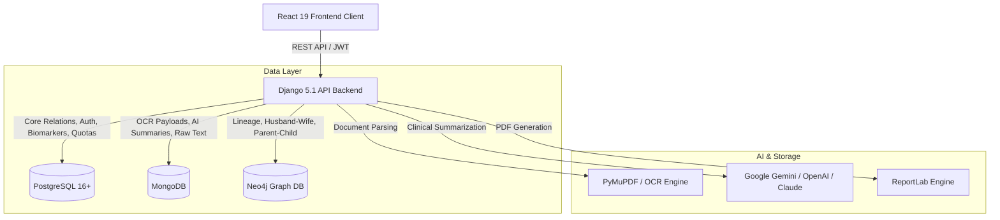

# HealthTrac — Longitudinal Health & Clinical Memory Platform

> **This repository is a standalone UX/UI design prototype.** Its runnable
> frontend presents a four-section HealthTrac introduction and a separate
> consultation-preparation page with local media and fictional sharing previews. It is separate from the production application; the
> architecture and API material below is reference documentation, not a claim
> that those services are implemented here. See [prototype setup and scope](frontend/INTEGRATION.md).

[](https://www.djangoproject.com/)
[](https://react.dev/)
[](https://www.postgresql.org/)
[](https://www.mongodb.com/)
[](https://neo4j.com/)
[](https://jwt.io/)
[-85EA2D?style=for-the-badge&logo=openapiinitiative)](http://127.0.0.1:8000/api/docs/)

HealthTrac is an enterprise-grade, longitudinal health tracking and clinical memory platform designed to preserve, organize, and synthesize lifelong medical records. Built with a polyglot multi-database architecture (**PostgreSQL**, **MongoDB**, and **Neo4j**), an AI-driven document intelligence pipeline, and a modern **React 19 + Vite** single-page application, HealthTrac empowers patients, families, and healthcare providers with secure health vaults, real-time biomarker analytics, ephemeral QR doctor sharing, and lineage tracking.

---

## Table of Contents

1. [Platform Overview & Key Capabilities](#platform-overview--key-capabilities)
2. [Polyglot Multi-Database Architecture](#polyglot-multi-database-architecture)
3. [Technology Stack](#technology-stack)
4. [System Architecture & Directory Layout](#system-architecture--directory-layout)
5. [Getting Started & Local Setup](#getting-started--local-setup)
   - [Prerequisites](#prerequisites)
   - [Backend Setup (Django + DBs)](#backend-setup)
   - [Frontend Setup (React + Vite)](#frontend-setup)
   - [Database Setup (PostgreSQL, MongoDB, Neo4j)](#database-setup)
6. [Environment Variables Reference](#environment-variables-reference)
7. [Interactive API Documentation](#interactive-api-documentation)
8. [Comprehensive Endpoints Reference](#comprehensive-endpoints-reference)
   - [1. Authentication, Users & Identity (`/api/auth/`)](#1-authentication-users--identity-apiauth)
   - [2. Dependent Child Profiles & Pediatric Care (`/api/auth/children/`)](#2-dependent-child-profiles--pediatric-care-apiauthchildren)
   - [3. Family Lineage Graph (`/api/auth/family-tree/`)](#3-family-lineage-graph-apiauthfamily-tree)
   - [4. Administrative Telemetry & User Roles (`/api/auth/admin/`)](#4-administrative-telemetry--user-roles-apiauthadmin)
   - [5. Private Cloud Vault (`/api/vault/`)](#5-private-cloud-vault-apivault)
   - [6. Clinical Timeline & Care Journeys (`/api/timeline/`)](#6-clinical-timeline--care-journeys-apitimeline)
   - [7. Clinical Intelligence & Biomarkers (`/api/intelligence/`)](#7-clinical-intelligence--biomarkers-apiintelligence)
   - [8. Ephemeral QR Access Control & Doctor Sharing (`/api/access-control/`)](#8-ephemeral-qr-access-control--doctor-sharing-apiaccess-control)
   - [9. Billing, Subscriptions & Gateways (`/api/billing/`)](#9-billing-subscriptions--gateways-apibilling)
9. [Frontend Client Application](#frontend-client-application)
10. [Testing & Quality Assurance](#testing--quality-assurance)

---

## Platform Overview & Key Capabilities

- 🔒 **Passphrase-Protected Cloud Vault**: Zero-knowledge capable private document vault for diagnostic lab reports, clinical imaging, discharge summaries, and prescriptions with instant lock/unlock controls and immutable file retention.
- 🧠 **AI Clinical Document Processing**: Automated text extraction via **PyMuPDF** combined with a multi-provider LLM pipeline (Google Gemini, OpenAI GPT-4o, Anthropic Claude, or local Ollama/vLLM models) to synthesize executive summaries and extract structured biomarker observations.
- 📊 **Biomarker Analytics & Trend Engine**: LOINC/canonical-coded longitudinal biomarker tracking with automated abnormal flag detection and statistical direction analytics (`rising`, `falling`, `stable`).
- 📄 **Executive Clinical Dossier PDF**: One-click holistic summary generation compiling episodes, documents, and lab findings into a ReportLab-styled confidential clinical report.
- 🤰 **Specialized Pregnancy & Maternity Journey**: Dedicated maternal care tracking (gestational week calculations, trimester markers, prenatal visits, maternal vitals, ultrasound scan records, and fetal heartbeat monitoring) strictly protected for female patients.
- 👶 **Dependent Pediatric Profiles**: Married users can create and manage dependent child profiles with exact age breakdowns (years, months, days), pediatric document vaults, and immunization records.
- 🌳 **Family Lineage Graph (Neo4j)**: Graph-powered relationship mapping (`MARRIED_TO`, `PARENT_OF`, `CHILD_OF`, `SIBLING_OF`, `FATHER_OF`, `MOTHER_OF`) with automated Django signal synchronization and fallback PostgreSQL graph synthesis.
- 🛡️ **Ephemeral Doctor QR Sharing**: Time-limited (15m, 1h, 24h), scoped QR code tokens (`full_history`, `emergency_summary`, `medication_history`, `pregnancy_history`) allowing attending physicians to access records without password sharing, featuring instant revocation.
- 💳 **Multi-Gateway Subscriptions & Quotas**: Free vs. Premium tiers with monthly quota enforcement (upload limits, QR shares), backed by Stripe, SSLCommerz, and bKash adapters.
- 🛠️ **Administrative Telemetry Dashboard**: Real-time cross-module analytics dashboard with user role management (promoting self-registered patients to Doctors, Staff, or Admins).

---

## Polyglot Multi-Database Architecture

HealthTrac leverages three specialized database systems, each tailored to its specific data access characteristics:



| Database | Primary Purpose | Models / Collections / Nodes |
|---|---|---|
| **PostgreSQL** | Relational core, transactional integrity, authentication, time-series biomarker metrics, QR access grants, subscriptions, audit logs. | `User`, `ChildProfile`, `Vault`, `VaultDocument`, `ClinicalEpisode`, `BiomarkerMeasurement`, `AccessGrant`, `Subscription`, `UserUsageQuota`. |
| **MongoDB** | High-volume unstructured documents, OCR raw text payloads, LLM prompt histories, cached AI clinical dossiers. | Collections: `clinical_summaries`, `ocr_extractions`, `document_metadata`. |
| **Neo4j** | Graph traversal of family trees, matrimonial links, guardianship lines, and pediatric relations. | Nodes: `(:Person {id, type, name, gender, dob})`. Relationships: `[:MARRIED_TO]`, `[:PARENT_OF]`, `[:CHILD_OF]`, `[:SIBLING_OF]`, `[:FATHER_OF]`, `[:MOTHER_OF]`. |

---

## Technology Stack

### Backend
- **Framework:** Python 3.11+, Django 5.1+, Django REST Framework (DRF) 3.15+
- **Security & Auth:** `djangorestframework-simplejwt`, `cryptography`
- **Database Drivers:** `psycopg2-binary` (PostgreSQL), `pymongo` (MongoDB), `neo4j` (Neo4j Bolt driver)
- **Document Intelligence:** `PyMuPDF` (fitz), `Pillow`, `pydantic`
- **LLM Integrations:** `google-genai`, `openai`, `anthropic`
- **PDF Generation:** `reportlab`
- **Payments:** `stripe` (with extensible SSLCommerz & bKash gateways)
- **Documentation:** `drf-spectacular` (OpenAPI 3.0 schema generation)
- **Task Scheduling & Caching:** `celery`, `redis`

### Frontend
- **Framework:** React 19, Vite 8
- **Routing:** React Router DOM v7
- **UI & Layout:** Bootstrap 5.3, custom modern glassmorphic CSS design system
- **State & Context:** React Context API (`AuthContext`), persistent JWT session storage
- **Linting & Tooling:** Oxlint, Vite Proxy (`/api` & `/media` forwarded to Django)

---

## System Architecture & Directory Layout

```
HealthTrac/
├── README.md                      # Primary project documentation
├── backend/                       # Django REST Framework application
│   ├── manage.py
│   ├── requirements.txt           # Python dependency specifications
│   ├── .env.example               # Environment variables template
│   ├── base/                      # Core configuration & settings
│   │   ├── settings.py            # Multi-DB configs (PostgreSQL, Mongo, Neo4j)
│   │   ├── urls.py                # Top-level API routing & OpenAPI schema
│   │   ├── db_clients.py          # MongoDB & Neo4j singleton connection pools
│   │   ├── mongo_service.py       # High-level MongoDB clinical summary service
│   │   ├── graph_service.py       # Neo4j FamilyGraph traversal & node operations
│   │   ├── permissions.py         # Role-based & Admin access guards
│   │   └── exceptions.py          # Unified DRF exception handlers
│   ├── authentication/            # User auth, children, family graph & admin telemetry
│   │   ├── models.py              # User (gender, marital_status) & ChildProfile
│   │   ├── signals.py             # Automatic Neo4j Person & Edge sync signals
│   │   ├── views.py               # Auth, ChildProfile, FamilyTree & AdminDashboard
│   │   └── serializers.py
│   ├── vault/                     # Passphrase-protected document vault
│   │   ├── models.py              # Vault & VaultDocument (with child link)
│   │   ├── services.py            # Vault crypto & AI extraction trigger
│   │   └── views.py
│   ├── timeline/                  # Clinical episodes & care journeys
│   │   ├── models.py              # ClinicalEpisode (pregnancy, chronic, surgical)
│   │   └── views.py               # Gender-aware filtering (female-only pregnancy)
│   ├── intelligence/              # Biomarkers & AI clinical summarization
│   │   ├── models.py              # BiomarkerMeasurement & PatientClinicalSummary
│   │   ├── extractors.py          # PyMuPDF text & biomarker extraction
│   │   ├── llm.py                 # Multi-LLM adapter (Gemini, OpenAI, Claude)
│   │   ├── pdf_generator.py       # ReportLab medical dossier PDF builder
│   │   └── views.py
│   ├── access_control/            # Ephemeral QR Doctor Sharing
│   │   ├── models.py              # AccessGrant & AccessScope
│   │   ├── services.py            # QR code base64 generator & token hasher
│   │   └── views.py               # Grant issuance, claiming, & record view
│   └── billing/                   # Subscriptions, usage quotas & gateways
│       ├── models.py              # Subscription & UserUsageQuota
│       ├── gateways.py            # Stripe, SSLCommerz, bKash adapters
│       └── views.py
└── frontend/                      # React 19 + Vite client application
    ├── package.json
    ├── vite.config.js             # Dev server with API reverse proxy
    ├── index.html
    └── src/
        ├── App.jsx                # Route definitions & security route guards
        ├── api.js                 # Unified fetch API client with auto-refresh
        ├── context/AuthContext.jsx # Auth state, role verification & tokens
        ├── components/Navbar.jsx  # Responsive navbar with status badges
        ├── pages/
        │   ├── AuthPage.jsx       # Dual-identifier login & registration
        │   ├── VaultPage.jsx      # Vault unlock, document manager & AI summary
        │   ├── TimelinePage.jsx   # Clinical episodes & health journeys
        │   ├── PregnancyPage.jsx  # Maternal care tracker (female-only)
        │   ├── ChildProfilePage.jsx # Pediatric profiles & age breakdown
        │   ├── ChildFormPage.jsx  # Register or update dependent children
        │   ├── ChildDocumentUploadPage.jsx # Upload child-specific records
        │   ├── IntelligencePage.jsx # Biomarker trend charts & AI Dossier
        │   ├── AccessControlPage.jsx # Ephemeral QR code generation & scanner
        │   ├── BillingPage.jsx    # Subscriptions & payment checkout
        │   ├── AdminDashboardPage.jsx # Platform telemetry & role manager
        │   └── ProfilePage.jsx    # User profile & Neo4j spouse linker
        └── utils/age.js           # Exact age calculator (years/months/days)
```

---

## Getting Started & Local Setup

### Prerequisites

- **Python:** 3.11 or newer
- **Node.js:** 18.0 or newer (npm or yarn)
- **PostgreSQL:** 14+ running locally or remotely
- **MongoDB:** 6.0+ running locally or MongoDB Atlas
- **Neo4j:** 5.0+ running locally (Neo4j Desktop / Community) or Neo4j AuraDB

---

### Backend Setup

1. **Navigate to the backend directory and create a virtual environment:**
   ```bash
   cd backend
   python3 -m venv venv
   source venv/bin/activate    # On Windows: venv\Scripts\activate
   ```

2. **Install Python dependencies:**
   ```bash
   pip install --upgrade pip
   pip install -r requirements.txt
   ```

3. **Configure Environment Variables:**
   ```bash
   cp .env.example .env
   ```
   Edit `.env` with your database credentials and API keys (see [Environment Variables Reference](#environment-variables-reference)).

4. **Apply Database Migrations:**
   ```bash
   python manage.py makemigrations
   python manage.py migrate
   ```

5. **Create a Superuser (for Admin Dashboard and Django Admin):**
   ```bash
   python manage.py createsuperuser
   ```

6. **Start the Django Development Server:**
   ```bash
   python manage.py runserver 127.0.0.1:8000
   ```
   Backend will be operational at `http://127.0.0.1:8000/`.

---

### Frontend Setup

1. **Navigate to the frontend directory:**
   ```bash
   cd frontend
   ```

2. **Install Node dependencies:**
   ```bash
   npm install
   ```

3. **Start the Vite Development Server:**
   ```bash
   npm run dev
   ```
   The application will be accessible at `http://localhost:5173/` (Vite automatically proxies API requests to `http://127.0.0.1:8000`).

---

### Database Setup

#### 1. PostgreSQL
Ensure a database named `healthtrac` exists:
```sql
CREATE DATABASE healthtrac;
CREATE USER healthtrac WITH PASSWORD 'yourpassword';
GRANT ALL PRIVILEGES ON DATABASE healthtrac TO healthtrac;
```

#### 2. MongoDB
For local installations, start the Mongo daemon:
```bash
mongod --dbpath /data/db
```
Or set `MONGODB_URI` in `.env` to your MongoDB Atlas connection string.

#### 3. Neo4j
Start Neo4j Desktop or run via Docker:
```bash
docker run -d \
  --name healthtrac-neo4j \
  -p 7474:7474 -p 7687:7687 \
  -e NEO4J_AUTH=neo4j/yourpassword \
  neo4j:5-community
```
Verify the connection in your browser at `http://localhost:7474/`.

---

## Environment Variables Reference

Create a `backend/.env` file based on `backend/.env.example`:

```ini
# Core Django
SECRET_KEY=your-secure-django-secret-key
DEBUG=True
ALLOWED_HOSTS=localhost,127.0.0.1

# PostgreSQL Configuration
POSTGRES_DB=healthtrac
POSTGRES_USER=healthtrac
POSTGRES_PASSWORD=yourpassword
POSTGRES_HOST=localhost
POSTGRES_PORT=5432
POSTGRES_CONN_MAX_AGE=60

# LLM Provider Configuration (auto | gemini | openai | anthropic | custom)
LLM_PROVIDER=auto

# 1. Google Gemini (Recommended)
GEMINI_API_KEY=AIzaSy...

# 2. OpenAI
OPENAI_API_KEY=sk-...

# 3. Anthropic (Claude)
ANTHROPIC_API_KEY=sk-ant-...

# 4. Custom Self-Hosted Model (vLLM / Ollama)
CUSTOM_LLM_BASE_URL=http://localhost:8000/v1
CUSTOM_LLM_API_KEY=
CUSTOM_LLM_MODEL=my-clinical-model

# MongoDB Configuration
MONGODB_URI=mongodb://localhost:27017
MONGODB_DB_NAME=healthtrac

# Neo4j Graph DB Configuration
NEO4J_URI=bolt://localhost:7687
NEO4J_USER=neo4j
NEO4J_PASSWORD=yourpassword
```

---

## Interactive API Documentation

HealthTrac includes auto-generated OpenAPI 3.0 specifications and interactive explorers powered by `drf-spectacular`:

| Tool | URL | Description |
|---|---|---|
| **Swagger UI** | `http://127.0.0.1:8000/api/docs/` | Interactive API playground with "Try it out" execution |
| **ReDoc** | `http://127.0.0.1:8000/api/redoc/` | Responsive, 3-panel API technical reference |
| **OpenAPI Schema** | `http://127.0.0.1:8000/api/schema/` | Raw JSON/YAML OpenAPI 3.0 specification |

---

## Comprehensive Endpoints Reference

### 1. Authentication, Users & Identity (`/api/auth/`)

Dual-identifier registration & login with support for both Email and Phone Number.

#### `POST /api/auth/register/`
Create a new user account. Every self-registered user is assigned the `patient` role. Administrative roles (`doctor`, `staff`, `admin`) are elevated exclusively by administrators.

- **Auth Required:** No | **Rate Limit:** 10/min
- **Request Body (`application/json`):**
  ```json
  {
    "email": "user@example.com",
    "phone_number": "+1234567890",
    "first_name": "Rahim",
    "last_name": "Uddin",
    "gender": "male",
    "marital_status": "married",
    "date_of_birth": "1995-05-15",
    "password": "StrongPassword123!"
  }
  ```
  *(Either `email` or `phone_number` must be provided. Choices for `gender`: `male`, `female`, `other`; `marital_status`: `single`, `married`, `divorced`, `widowed`)*

- **Response (`201 Created`):**
  ```json
  {
    "user": {
      "id": "3fa85f64-5717-4562-b3fc-2c963f66afa6",
      "email": "user@example.com",
      "phone_number": "+1234567890",
      "role": "patient",
      "first_name": "Rahim",
      "last_name": "Uddin",
      "full_name": "Rahim Uddin",
      "gender": "male",
      "marital_status": "married",
      "date_of_birth": "1995-05-15",
      "age": 31,
      "age_display": "31 years",
      "is_married": true,
      "is_admin": false,
      "created_at": "2026-10-07T09:00:00Z"
    },
    "refresh": "eyJhbGciOiJIUzI1Ni...",
    "access": "eyJhbGciOiJIUzI1Ni..."
  }
  ```

#### `POST /api/auth/login/`
Authenticate using either email **or** phone number with password.

- **Request Body:**
  ```json
  {
    "identifier": "user@example.com",
    "password": "StrongPassword123!"
  }
  ```
- **Response (`200 OK`):** Same schema as registration containing `user`, `refresh`, and `access` tokens.

#### `POST /api/auth/token/refresh/`
Renew expired JWT access tokens using a valid refresh token.
- **Request Body:** `{"refresh": "<refresh_token>"}`
- **Response (`200 OK`):** `{"access": "<new_access_token>", "refresh": "<refresh_token>"}`

#### `POST /api/auth/logout/`
Revoke and blacklist the refresh token to immediately invalidate the session.
- **Auth Required:** Yes (`Bearer <token>`)
- **Request Body:** `{"refresh": "<refresh_token>"}`
- **Response (`205 Reset Content`):** Empty.

#### `GET /api/auth/me/` & `PATCH /api/auth/me/`
Retrieve or partially update the authenticated user's profile.
- **Auth Required:** Yes (`Bearer <token>`)

#### `POST /api/auth/change-password/`
Change user account password securely.
- **Request Body:** `{"current_password": "...", "new_password": "..."}`
- **Response (`204 No Content`):** Empty.

---

### 2. Dependent Child Profiles & Pediatric Care (`/api/auth/children/`)

Manage dependent children profiles under the authenticated user. **Note:** Only married users (`marital_status: "married"`) are permitted to manage child profiles.

#### `GET /api/auth/children/`
List dependent children belonging to the authenticated parent.
- **Auth Required:** Yes (`Bearer <token>`)
- **Response (`200 OK`):**
  ```json
  [
    {
      "id": "7bc34190-2819-482a-9cb8-0130dbfa6712",
      "parent": "3fa85f64-5717-4562-b3fc-2c963f66afa6",
      "first_name": "Aayan",
      "last_name": "Uddin",
      "full_name": "Aayan Uddin",
      "father_name": "Rahim Uddin",
      "mother_name": "Nusrat Jahan",
      "date_of_birth": "2023-04-10",
      "gender": "male",
      "blood_group": "O+",
      "allergies": "Peanuts",
      "emergency_contact": "+1234567890",
      "age_display": "3 years, 6 months, 5 days",
      "documents_count": 4,
      "created_at": "2026-10-10T10:00:00Z"
    }
  ]
  ```

#### `POST /api/auth/children/`
Create a new dependent child profile. Automatically syncs to the Neo4j Graph DB as a `:Person` node and establishes `[:PARENT_OF]` and `[:SIBLING_OF]` edges.
- **Auth Required:** Yes (`Bearer <token>`, must be married)
- **Request Body:**
  ```json
  {
    "first_name": "Aayan",
    "last_name": "Uddin",
    "father_name": "Rahim Uddin",
    "mother_name": "Nusrat Jahan",
    "date_of_birth": "2023-04-10",
    "gender": "male",
    "blood_group": "O+",
    "allergies": "Peanuts",
    "emergency_contact": "+1234567890"
  }
  ```
- **Response (`201 Created`):** Child profile object.

#### `GET /api/auth/children/{id}/`, `PATCH /api/auth/children/{id}/`, `DELETE /api/auth/children/{id}/`
Retrieve, update, or delete a child profile. Deletion cascades to the Neo4j graph node.

---

### 3. Family Lineage Graph (`/api/auth/family-tree/`)

Connects and queries biological and matrimonial family links within the **Neo4j Graph Database**.

#### `GET /api/auth/family-tree/`
Retrieve the complete family graph around the authenticated user. If Neo4j is offline, automatically falls back to synthesizing the tree from PostgreSQL child profiles.
- **Auth Required:** Yes (`Bearer <token>`)
- **Response (`200 OK`):**
  ```json
  {
    "source": "neo4j",
    "nodes": [
      { "id": "3fa85f64...", "name": "Rahim Uddin", "type": "user", "gender": "male" },
      { "id": "9bc12130...", "name": "Nusrat Jahan", "type": "user", "gender": "female" },
      { "id": "7bc34190...", "name": "Aayan Uddin", "type": "child", "gender": "male", "blood_group": "O+" }
    ],
    "edges": [
      { "from": "3fa85f64...", "to": "9bc12130...", "relation": "MARRIED_TO" },
      { "from": "3fa85f64...", "to": "7bc34190...", "relation": "FATHER_OF" },
      { "from": "9bc12130...", "to": "7bc34190...", "relation": "MOTHER_OF" }
    ]
  }
  ```

#### `POST /api/auth/family-tree/`
Link the authenticated user with a registered spouse in the Neo4j Graph DB.
- **Auth Required:** Yes (`Bearer <token>`)
- **Request Body:**
  ```json
  {
    "spouse_email": "spouse@example.com"
  }
  ```
  *(Or provide `"spouse_id": "<uuid>"`)*
- **Response (`200 OK`):**
  ```json
  {
    "detail": "Linked Rahim Uddin and Nusrat Jahan as spouses in Graph DB.",
    "spouse": {
      "id": "9bc12130-...",
      "name": "Nusrat Jahan",
      "email": "spouse@example.com"
    }
  }
  ```

---

### 4. Administrative Telemetry & User Roles (`/api/auth/admin/`)

Administrative control endpoints reserved for users with `admin` or `staff` roles.

#### `GET /api/auth/admin/dashboard/`
Live platform-wide cross-module operational telemetry.
- **Auth Required:** Yes (`admin` or `staff` role required)
- **Response (`200 OK`):**
  ```json
  {
    "overview": {
      "total_users": 150,
      "total_documents": 482,
      "total_episodes": 98,
      "total_biomarkers": 630,
      "total_summaries": 45,
      "total_grants": 112,
      "total_subscriptions": 150
    },
    "users": {
      "total": 150,
      "by_role": { "patient": 135, "doctor": 10, "staff": 3, "admin": 2 },
      "active": 148,
      "inactive": 2,
      "new_7d": 14,
      "new_30d": 52
    },
    "vault": {
      "total_vaults": 120,
      "unlocked_vaults": 15,
      "locked_vaults": 105,
      "total_documents": 482,
      "by_category": { "lab_report": 250, "prescription": 140, "imaging": 92 }
    },
    "timeline": {
      "total_episodes": 98,
      "active_episodes": 24,
      "by_type": { "pregnancy": 40, "chronic": 38, "surgical": 20 }
    },
    "intelligence": {
      "total_biomarkers": 630,
      "abnormal_biomarkers": 42,
      "normal_biomarkers": 588,
      "total_summaries": 45
    },
    "billing": {
      "total_subscriptions": 150,
      "by_tier": { "free": 120, "premium_monthly": 25, "premium_yearly": 5 },
      "current_month_uploads": 85,
      "current_month_qr_shares": 40
    }
  }
  ```

#### `GET /api/auth/admin/users/`
List and filter users across the platform.
- **Query Parameters:** `search`, `role` (`patient`, `doctor`, `staff`, `admin`), `is_active` (`true`/`false`)
- **Response (`200 OK`):** Array of detailed user profiles.

#### `PATCH /api/auth/admin/users/{id}/`
Promote or demote user roles, or toggle user account activation status.
- **Request Body:**
  ```json
  {
    "role": "doctor",
    "is_active": true
  }
  ```
- **Response (`200 OK`):** Updated user object.

---

### 5. Private Cloud Vault (`/api/vault/`)

Secure, passphrase-protected vault for medical documents, lab tests, scans, and prescriptions.

| Method | Endpoint | Description | Auth Required |
|---|---|---|---|
| `GET` | `/api/vault/` | Get vault status (`is_open`, `document_count`) | Yes |
| `POST` | `/api/vault/` | Initialize private vault with a passphrase | Yes |
| `POST` | `/api/vault/unlock/` | Unlock vault with passphrase to enable document access | Yes |
| `POST` | `/api/vault/lock/` | Lock vault (subsequent document requests return `423 Locked`) | Yes |
| `POST` | `/api/vault/passphrase/` | Change existing vault passphrase | Yes |
| `GET` | `/api/vault/documents/` | List documents inside unlocked vault (supports `category`, `type`, `tag`, `search`, `child`, `for_child=false`) | Yes (Unlocked) |
| `POST` | `/api/vault/documents/` | Upload medical document (`multipart/form-data`) with optional `child` UUID | Yes (Unlocked) |
| `GET` | `/api/vault/documents/{id}/` | Retrieve document metadata | Yes (Unlocked) |
| `PATCH` | `/api/vault/documents/{id}/` | Update document metadata (title, category, tags) | Yes (Unlocked) |
| `DELETE` | `/api/vault/documents/{id}/` | Delete document and physical file | Yes (Unlocked) |
| `GET` | `/api/vault/documents/{id}/download/` | Stream download of the original document file | Yes (Unlocked) |
| `POST` | `/api/vault/documents/{id}/summarize/` | Trigger AI text extraction and diagnostic summary on document | Yes (Unlocked) |

#### Document Upload Parameters:
- `file` (Binary): Document file (PDF, PNG, JPG, WEBP, DOCX, max 25MB)
- `title` (String): Document title
- `file_category` (String): `lab_report`, `prescription`, `imaging`, `insurance`, `vaccination`, `discharge_summary`, `personal_note`, `other`
- `child` (UUID, Optional): ID of dependent child if uploading a pediatric record
- `description` (String, Optional): Notes
- `tags` (JSON Array, Optional): e.g. `["blood", "lipid_panel"]`

---

### 6. Clinical Timeline & Care Journeys (`/api/timeline/`)

Tracks ongoing and historical medical care journeys (Pregnancy Care, Chronic Conditions, Surgical Episodes).

| Method | Endpoint | Description | Auth Required |
|---|---|---|---|
| `GET` | `/api/timeline/episodes/` | List patient episodes (`?type=...`, `?active_only=true`) | Yes |
| `POST` | `/api/timeline/episodes/` | Create a clinical episode (`pregnancy`, `chronic`, `surgical`) | Yes |
| `GET` | `/api/timeline/episodes/{id}/` | Retrieve episode details | Yes |
| `PATCH` | `/api/timeline/episodes/{id}/` | Update episode or close with `end_date` | Yes |
| `DELETE` | `/api/timeline/episodes/{id}/` | Delete a clinical episode | Yes |

> [!IMPORTANT]
> **Gender Access Control:** In accordance with platform clinical rules, episodes with `episode_type="pregnancy"` are **strictly restricted to female patients**. Requests by non-female users to view or create pregnancy episodes will be excluded or rejected with `403 Forbidden`.

---

### 7. Clinical Intelligence & Biomarkers (`/api/intelligence/`)

Time-series biomarker tracking, automated abnormal value detection, and holistic AI summaries.

| Method | Endpoint | Description | Auth Required |
|---|---|---|---|
| `GET` | `/api/intelligence/biomarkers/` | List recorded biomarker readings (`?marker=...`, `?abnormal=true`, `?from=...`, `?to=...`) | Yes |
| `POST` | `/api/intelligence/biomarkers/` | Record a biomarker measurement manually | Yes |
| `GET` | `/api/intelligence/biomarkers/{id}/` | Retrieve a single biomarker measurement | Yes |
| `PATCH` | `/api/intelligence/biomarkers/{id}/` | Update biomarker value or reference bounds | Yes |
| `DELETE` | `/api/intelligence/biomarkers/{id}/` | Delete a biomarker measurement | Yes |
| `GET` | `/api/intelligence/biomarkers/markers/` | Summary of all distinct biomarkers tracked with latest values | Yes |
| `GET` | `/api/intelligence/biomarkers/trend/` | Time-series trend analytics (`?marker=Hemoglobin`) with direction | Yes |
| `POST` | `/api/intelligence/summarize/` | **Holistic AI Clinical Summary**: Compiles patient timeline, lab values, and reports into an LLM executive summary dossier | Yes |
| `GET` | `/api/intelligence/summarize/` | Retrieve past AI clinical summaries | Yes |
| `GET` | `/api/intelligence/summarize/pdf/` | **Download Clinical Dossier PDF**: Generates and downloads a beautifully formatted, confidential ReportLab PDF medical report | Yes |

---

### 8. Ephemeral QR Access Control & Doctor Sharing (`/api/access-control/`)

Empowers patients to generate time-limited, scope-restricted QR access grants for physicians.

| Method | Endpoint | Description | Auth Required |
|---|---|---|---|
| `GET` | `/api/access-control/grants/` | List active and historical doctor access grants generated by the patient | Yes |
| `POST` | `/api/access-control/grants/` | Generate a new ephemeral doctor access grant (returns raw token & base64 QR PNG) | Yes |
| `POST` | `/api/access-control/grants/{id}/revoke/` | Instantly revoke an active doctor grant | Yes |
| `POST` | `/api/access-control/grants/claim/` | Doctor portal endpoint: claim access via scanned QR raw token | Yes (Doctor Role) |
| `GET` | `/api/access-control/records/{grant_id}/` | Doctor portal endpoint: retrieve patient records authorized by the grant scope | Yes (Claiming Doctor) |

#### Available Grant Scopes:
- `full_history`: Complete longitudinal timeline, biomarkers, and vault documents
- `emergency_summary`: Quick emergency triage summary (abnormal biomarkers and ongoing episodes)
- `medication_history`: Prescriptions and current medications
- `pregnancy_history`: Maternity journey episodes, ultrasound scans, and maternal vitals

---

### 9. Billing, Subscriptions & Gateways (`/api/billing/`)

Subscription tier management, quota enforcement, and payment gateway checkout sessions.

| Method | Endpoint | Description | Auth Required |
|---|---|---|---|
| `GET` | `/api/billing/subscription/` | View current subscription tier (`free`, `premium_monthly`, `premium_yearly`) | Yes |
| `GET` | `/api/billing/usage/` | View current calendar month's usage quotas (documents uploaded, QR shares generated) | Yes |
| `POST` | `/api/billing/checkout/` | Initiate upgrade checkout session (Stripe, SSLCommerz, bKash) | Yes |
| `POST` | `/api/billing/subscription/cancel/` | Cancel auto-renewal at period end | Yes |
| `POST` | `/api/billing/webhooks/{gateway}/` | Payment processor webhook handler (`stripe`, `sslcommerz`, `bkash`) | No (Signed) |

---

## Frontend Client Application

The HealthTrac web client is built with **React 19** and **Vite 8**, featuring responsive layouts, Bootstrap 5.3 utilities, dynamic micro-interactions, and instant feedback.

### Key Client Features & Routes:
- `/` or `/profile`: User Profile, marital status, gender, password change, and Neo4j spouse graph linking.
- `/vault`: Passphrase unlock modal, instant lock button, document upload modal, category filters, download stream, and inline AI summarizer.
- `/pregnancy`: Specialized Maternity Care Journey (restricted to female users; redirected automatically for non-female users).
- `/children`: Dependent child profiles with exact age display (`X years, Y months, Z days`), immunization notes, and pediatric documents.
- `/children/new` & `/children/edit/:id`: Pediatric profile registration and editor.
- `/children/add-document`: Direct pediatric document upload modal.
- `/timeline`: Longitudinal clinical episode list with active episode indicators and new episode creation.
- `/intelligence`: Biomarker tracking table, abnormal flags, interactive trend visualization, AI clinical dossier generation, and one-click PDF download.
- `/access-control`: Ephemeral QR code generator with live countdown timers, QR code modal preview, instant revocation, and doctor grant claim input.
- `/billing`: Current plan badges, quota consumption progress bars, and gateway upgrade buttons.
- `/admin-dashboard`: Platform operational telemetry and user role promotion (`AdminRoute` protected).

---

## Testing & Quality Assurance

HealthTrac includes test suites across backend modules:

```bash
cd backend
python manage.py test
```

To run tests for specific modules:
```bash
python manage.py test authentication
python manage.py test vault
python manage.py test timeline
python manage.py test intelligence
python manage.py test access_control
python manage.py test billing
```

Frontend linting:
```bash
cd frontend
npm run lint
```

---

## Security, Privacy & Compliance

- **Role-Based Privilege Elevation:** Self-registration is strictly isolated to normal patients. Only system administrators can elevate roles to Doctor, Staff, or Admin.
- **Passphrase-Protected Vaults:** File access requires an explicitly unlocked session; locked vaults strictly reject document requests with `HTTP 423 Locked`.
- **Ephemeral Doctor Tokens:** QR codes contain single-use or short-duration hashed tokens that can be revoked by the patient in real time.
- **Gender-Sensitive Privacy:** Maternity and pregnancy records are protected both on the client via route guards and enforced strictly at the database query level on the server.
- **Token Blacklisting:** User logouts immediately blacklist refresh tokens via Django SimpleJWT's token blacklist table.

---

## License

This project is licensed under the MIT License. See [LICENSE](LICENSE) for details.
